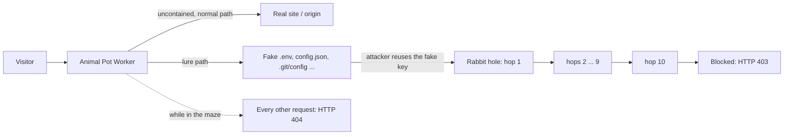

# Animal Pot


**An edge honeypot for automated attackers, running on Cloudflare Workers.**

Animal Pot sits in front of a real website as a Cloudflare Worker. Ordinary
visitors reach the site as normal. A scanner, bot, or AI agent that goes
looking for secrets finds planted fake credentials. If it uses them, it is
pulled into a chain of fake API data, kept away from the real site, and then
blocked. An Access-protected dashboard shows every detection and lets an
operator release a blocked source.

Animal Pot is a fork of [juliourena/moqesh](https://github.com/juliourena/moqesh),
rebuilt for Cloudflare's edge. It no longer ships the upstream Python server,
remote sensors, or Docker images. Internal names (the `moqesh` Worker, the
`MOQESH_` prefixes) are kept from the upstream code.

**Documentation:** [Cloudflare Worker, deployment, and demo](cloudflare/README.md)
· [staging acceptance evidence](cloudflare/test/staging-acceptance.md)
· [security](SECURITY.md)

## How it works



1. **Pass-through.** Every request to the protected hostname goes through the
   Worker. Visitors who are not contained are forwarded to the real origin,
   and nothing is logged for them.
2. **Lure.** Common leak paths (`/.env`, `/.env.production`, `/.git/config`,
   `/.aws/credentials`, `/config.json`, `/wp-config.php.bak`, `/backup.sql`,
   `/api/v1/keys`, `/swagger.json`, plus `robots.txt` hints) return
   convincing files that contain the same synthetic API key and point to a
   bait API. Viewing a lure is logged, but it does not count as an attack.
3. **Confirm.** Calling the bait API with that key proves intent. The source
   IP is confirmed and moved into the **maze**: from then on, the real site
   and every other path return `404` to it.
4. **Rabbit hole.** The bait response is hop 1 of a 10-hop chain of fake data
   (billing, team, admin users, API keys, internal services, deploy secrets,
   database credentials, backups, vault root). Each hop hands over the next
   endpoint and a bearer token. All values are derived with HMAC and contain
   no real secrets. Skipping a hop or using a wrong token gets the maze `404`.
5. **Block.** Reaching hop 10 blocks the source immediately (`403`, 24 hours
   by default). A source that never finishes the chain is blocked once the
   maze time limit runs out.
6. **Operate.** The admin dashboard, on a separate hostname behind Cloudflare
   Access, lists detections and contained sources. It records an audit entry
   for every manual unblock.

Containment is keyed on the **public source IP**, not the browser or the
device. An IPv4 and an IPv6 address from the same machine are separate
sources.

## Architecture

| Component | Cloudflare service | Role |
|---|---|---|
| Animal Pot Worker | Workers (whole-host route) | Lures, bait API, rabbit hole, maze, block, pass-through to the origin |
| Per-source state | Durable Objects (`AgentSession`) | Containment state and chain depth for each source IP |
| Event store | D1 | Detections, settings, allowlist, audit log, containment index |
| Dashboard | Workers static assets + Cloudflare Access | Operator UI and `/api/admin/*`, served only on the admin hostname |
| Staging origin | Separate Worker (service binding) | Isolated demo site for staging, so production is never touched |
| Infrastructure | Terraform (HCP Terraform state) | Worker, D1 and migrations, Access app, routes; no DNS changes |

## Repository layout

```
cloudflare/
  src/               Worker: routing, lures, rabbit hole, sessions, admin API
  dashboard/         React + TypeScript operator dashboard (Vite)
  migrations/        D1 schema migrations (0001-0005)
  staging-origin/    isolated static origin used for staging
  terraform/         customer-owned Terraform deployment
  scripts/           guided attack demo (demo_attack.py)
  test/              Worker, deployment, origin, and demo tests
docs/superpowers/    design specs and implementation plans
```

The remaining top-level code (`moqesh/`, `web/`, `tests/`, `deploy/`, the
`Dockerfile`) is inherited from upstream. Animal Pot's deployment does not
use it.

## Quick start

Requires Node.js and npm. The guided demo needs Python 3.11+ and no extra
packages.

```sh
cd cloudflare
npm ci
npm test -- --run          # Worker unit and integration tests
npm run test:deployment    # Terraform and deployment checks
npm run test:staging-origin
npm run check:bindings
npm run typecheck
npm run build              # dashboard build + Wrangler dry run (no deploy)
```

Run the demo test suite (it sends no network requests) from the repository root:

```sh
python3 -m unittest discover -s cloudflare/test -p 'demo_attack_test.py' -v
```

CI ([`.github/workflows/cloudflare.yml`](.github/workflows/cloudflare.yml)) runs
these checks plus `terraform fmt` and `terraform validate` on pull requests and
pushes that touch `cloudflare/`. It uses no Cloudflare or Terraform
credentials and never deploys.

## Deploying

Deployment is Terraform-driven. The customer owns the Cloudflare account, the
zone, the Terraform state, the API tokens, and the Worker secrets. Every apply
is reviewed from a saved plan. Roll out to a dedicated staging hostname first.
Production routing needs its own reviewed and approved plan. Full procedure,
required token permissions, rollback, and uninstall:
[`cloudflare/README.md`](cloudflare/README.md#customer-owned-terraform-deployment).

## Demo

`cloudflare/scripts/demo_attack.py` walks through the full attack in eight
operator-approved stages:

1. normal visit
2. missing key
3. bait discovery
4. key reuse
5. maze `404`
6. rabbit hole, hops 2–10
7. block `403`
8. manual unblock and recovery

The script shows every request and response. This is a live exercise: it
contains the IP you run it from. See
[Guided attack demonstration](cloudflare/README.md#guided-attack-demonstration).

## Known limitations

- Containment is keyed on the IP address. Every user behind a shared NAT or VPN exit is affected together.
- Webhook delivery is disabled in the current deployment.
- Lure responses can be overridden by existing zone security rules (for
  example, a WAF rule that returns `403` for `wp-config` paths).
- During an update, the Worker deploys a few seconds before D1 migrations
  finish running.

## License

**AGPL-3.0-or-later**. See [`LICENSE`](LICENSE) and [`NOTICE`](NOTICE).
Based on Moqesh AI © 2026 Julio Ureña ([juliourena/moqesh](https://github.com/juliourena/moqesh)).

Under the AGPL, if you distribute a modified version **or offer it as a
network service**, you must publish its source code under AGPL-3.0 and keep
this attribution.
