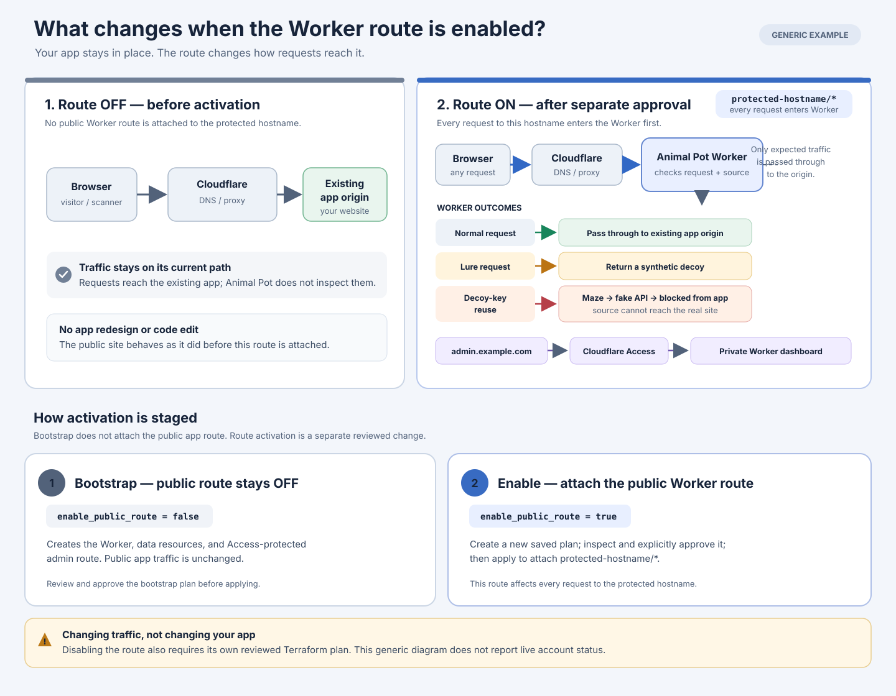

# Deploying Animal Pot in front of your app

This guide takes you from zero to a working Animal Pot installation on your own
Cloudflare account. Animal Pot runs as a Cloudflare Worker in front of an
existing website: ordinary visitors reach your site unchanged, while scanners
that probe for secrets get fake credentials, are pulled through a 10-hop
"rabbit hole" of fake API data, and are then blocked from the real site. An
Access-protected dashboard on a separate hostname shows the events and lets you
unblock sources.



Everything below uses placeholder names. Replace them with your own:

| Placeholder | Meaning |
|---|---|
| `example.com` | Your domain (a Cloudflare zone) |
| `app.example.com` | The **protected hostname**: the existing site Animal Pot sits in front of |
| `admin.example.com` | The **admin hostname**: the private operator dashboard |
| `you@example.com` | Operator email(s) allowed into the dashboard |
| `your-team` | Your Cloudflare Zero Trust team name |
| `your-org` / `animalpot-prod` | Your HCP Terraform organization / workspace |

Deployment is done with the Terraform module in
[`cloudflare/terraform`](../cloudflare/terraform). For the full technical
reference (traffic model, every variable, safety rules) see
[`cloudflare/README.md`](../cloudflare/README.md).

> **Practice first.** Do the whole guide once against a staging hostname (for
> example `staging.example.com`) with its own workspace, then repeat it for
> your real site. A route attached to a hostname affects **every** request to
> that hostname.

---

## A. What you need

| Item | Notes |
|---|---|
| A domain on Cloudflare | Nameservers pointed at Cloudflare. Free plan is fine. |
| A Cloudflare account you administer | To create API tokens and Zero Trust settings. |
| Cloudflare Zero Trust | Provides Access login for the dashboard. Choose the plan that fits your usage and follow any billing prompts shown in the current onboarding flow. |
| HCP Terraform account (free) | Stores Terraform state remotely. <https://app.terraform.io> |
| Node.js 22+ and npm | Builds the Worker and dashboard. |
| Terraform CLI 1.10+ | <https://developer.hashicorp.com/terraform/install> |
| git | To clone the repository. |
| `openssl` | To generate random values (any secure generator works). |
| Python 3.11+ *(optional)* | Only for the guided attack demo script. |
| An HTTPS webhook URL *(optional)* | Slack/Teams/etc. incoming webhook for alerts. You can deploy without alerts. |

**Cost.** The route covers the whole protected hostname, so every request to
your site invokes the Worker. Check current [Workers pricing](https://developers.cloudflare.com/workers/platform/pricing/),
[D1 pricing](https://developers.cloudflare.com/d1/platform/pricing/),
[Durable Objects pricing](https://developers.cloudflare.com/durable-objects/platform/pricing/),
and [Cloudflare One pricing](https://www.cloudflare.com/plans/zero-trust-services/)
for request quotas, included allowances, and paid-plan requirements before
going live; traffic to your real site counts as Worker requests too.

---

## B. Get the code and check it builds

```sh
git clone https://github.com/hackershmave1/moqesh.git animalpot
cd animalpot/cloudflare
npm ci
npm test -- --run
npm run test:deployment
npm run test:staging-origin
npm run check:bindings
npm run typecheck
npm run build        # produces .wrangler-out/ which Terraform uploads
```

All commands must pass. Re-run `npm run build` whenever you pull new code; Terraform
uploads exactly what the build produced.

---

## C. Prepare your Cloudflare zone

### C1. Find your account ID and zone ID

In the [Cloudflare dashboard](https://dash.cloudflare.com), open your domain.
On the **Overview** page, the right-hand **API** panel shows the **Zone ID** and
**Account ID** (both 32 hex characters). Copy both.

### C2. Choose how Animal Pot reaches your site (`origin_type`)

| Your site is… | Use | What to set |
|---|---|---|
| A normal server/host behind a proxied DNS record (VM, container, PaaS, another CDN, Pages via CNAME) | **`dns`** (recommended) | `origin_type = "dns"`, `origin_service_name = ""` |
| Itself a Cloudflare Worker | **`worker`** | `origin_type = "worker"`, `origin_service_name = "<that Worker's name>"` |

In `dns` mode, ordinary traffic is passed through to whatever your
protected hostname's DNS record points to. Animal Pot only forwards requests
whose hostname is exactly your protected hostname, so it cannot be used as an
open proxy.

### C3. Create (or confirm) the DNS records

Terraform **never creates or edits DNS**. Both hostnames must already exist as
**proxied** (orange-cloud) records in the zone. In **DNS → Records**:

| Hostname | Record | Proxy |
|---|---|---|
| `app.example.com` | Your existing A/AAAA/CNAME pointing at your site | **Proxied** |
| `admin.example.com` | `AAAA` → `100::` (a placeholder; the dashboard is served entirely by the Worker) | **Proxied** |

If your site record is currently "DNS only" (grey cloud), switch it to Proxied
and confirm the site still works before continuing.

### C4. Check for conflicting Worker routes

In **Workers Routes** for the zone, look for routes matching either hostname.
Terraform stops if another Worker already owns a route for exactly
`app.example.com/*` or `admin.example.com/*`, or a path-specific wildcard
route covers them. A zone-wide `*.example.com/*` route is fine; Animal Pot's
more specific routes take precedence for its two hostnames.

### C5. Check WAF rules for lure paths

Some managed WAF rules block requests such as `/wp-config.php.bak` before they
reach any Worker. That is harmless (the scanner is blocked anyway), but if you
want every lure to answer, review **Security → WAF** events for those paths
after deployment.

---

## D. Set up Cloudflare Zero Trust (dashboard login)

1. In the Cloudflare dashboard open **Zero Trust**. If this is your first time,
   pick a **team name** (for example `your-team`) and a suitable plan. Your
   team domain becomes `your-team.cloudflareaccess.com`. Choose a team name
   your operators will recognize and retain.
2. Go to **Settings → Authentication → Login methods** and add **One-time PIN**
   (Access emails a code to allowed addresses). You can also add Google,
   GitHub, Entra ID, Okta, etc.
3. Note the team domain (`your-team.cloudflareaccess.com`) and the operator
   email addresses to allow. Terraform creates the Access application and
   policy itself; you do not create them by hand.

---

## E. Create the Cloudflare API token

Dashboard → **My Profile → API Tokens → Create Token → Create Custom Token**.

Permissions:

| Scope | Permission | Level |
|---|---|---|
| Account | Workers Scripts | Edit |
| Account | D1 | Edit |
| Account | Access: Apps and Policies | Edit |
| Zone | Workers Routes | Edit |
| Zone | Zone | Read |
| Zone | DNS | Read |

Resources:

- **Account resources:** Include → your account.
- **Zone resources:** Include → Specific zone → `example.com`.

Optionally restrict client IPs and set an expiry (TTL). Create the token and
store it in a password manager or secret store; it is shown only once. Do
**not** use the Global API Key, and do not grant DNS Edit; it is not needed.

---

## F. Set up HCP Terraform (remote state)

1. Sign up at <https://app.terraform.io> and create an **organization**
   (for example `your-org`). Use the organization **name** later, not the
   `org-…` ID.
2. Create a **workspace** with the **CLI-driven workflow**. Name it after the
   installation, for example `animalpot-prod` (and a separate
   `animalpot-staging` for practice). One workspace per installation; never
   share one between installations.
3. In the workspace **Settings → General**, set **Execution Mode** to
   **Local**. This is required: Terraform must read your local build and run
   the bundled D1-migration and secret-upload helpers on your machine. HCP
   Terraform still stores and locks the state.
4. Create a user API token: **User settings → Tokens → Create an API token**.
   Store it securely.

---

## G. Generate installation values and secrets

```sh
openssl rand -hex 16   # installation_id (non-secret, keep it stable forever)
openssl rand -hex 32   # lure key secret (SECRET, unique per installation)
```

- `installation_id` identifies this installation; it goes in tfvars.
- The lure key secret signs the fake credentials. It is uploaded as a Worker
  secret at apply time and never stored in tfvars or Terraform state. Keep it
  in your secret manager.

---

## H. Write your configuration (tfvars)

```sh
cd cloudflare/terraform
cp examples/basic.tfvars.example terraform.tfvars   # *.tfvars is git-ignored
```

Edit `terraform.tfvars`:

```hcl
account_id         = "<32-hex account ID>"
zone_id            = "<32-hex zone ID>"
protected_hostname = "app.example.com"
admin_hostname     = "admin.example.com"
origin_type         = "dns"   # or "worker" (see C2)
origin_service_name = ""      # Worker name when origin_type = "worker"
installation_id    = "<value from G>"
access_team_domain    = "your-team.cloudflareaccess.com"
access_allowed_emails = ["you@example.com"]
allowlisted_sources   = ["203.0.113.10"]   # your office/VPN IPs: never trapped
alert_webhook_enabled = false              # set true only if you have an HTTPS webhook URL
agent_session_migration_applied = false    # keep false for the first apply
enable_public_route   = false              # keep false for the first apply
```

Leave `lure_paths` and `bait_api_path` as in the example unless you know you
need different ones; validation requires they match the built-in lures.
Optional: change `worker_name` (default `moqesh-cloudflare`) and
`d1_database_name` (default `moqesh-events`) if you run several installations
in one account. Never put secrets in this file.

Key runtime knobs (all can later be changed from the dashboard):
`maze_duration_minutes`, `block_duration_hours`, `response_budget`,
`retention_days`.

---

## I. Set environment variables and initialize Terraform

In the shell that will run Terraform (do not paste secrets into files that get
committed; a password-manager CLI or `read -s` is ideal):

```sh
export TF_CLOUD_ORGANIZATION=your-org
export TF_WORKSPACE=animalpot-prod
read -rs TF_TOKEN_app_terraform_io && export TF_TOKEN_app_terraform_io
read -rs CLOUDFLARE_API_TOKEN && export CLOUDFLARE_API_TOKEN
read -rs MOQESH_LURE_KEY_SECRET && export MOQESH_LURE_KEY_SECRET

terraform init -input=false
```

If `alert_webhook_enabled = true`, also run:

```sh
read -rs MOQESH_ALERT_WEBHOOK_URL && export MOQESH_ALERT_WEBHOOK_URL
```

(`terraform login` is an alternative to `TF_TOKEN_app_terraform_io`.)

---

## J. Stage 1: bootstrap (no public traffic yet)

With `enable_public_route = false`, this creates the Worker, D1 database and
migrations, Durable Object, secrets, cron trigger, Access application, and the
admin route. Your public site is **not** touched yet.

```sh
terraform plan -var-file=terraform.tfvars -out=bootstrap.tfplan
terraform show -no-color bootstrap.tfplan | less
```

Review the plan. It should only **create** Animal Pot resources: no DNS, no
deletion or replacement of anything you already had, and no route for
`app.example.com`. Then apply exactly that plan (never use `-auto-approve`):

```sh
terraform apply bootstrap.tfplan
```

Verify:

```sh
terraform output d1_migrations_verified          # must be true
terraform output worker_secret_bindings_verified  # must be true
```

Open `https://admin.example.com`. You should get the Cloudflare Access login.
Enter your allowed email, then the PIN, and you should see the dashboard.

**Then set `agent_session_migration_applied = true` in `terraform.tfvars`.**
Every later plan needs this; without it, Worker updates fail with HTTP 412.

---

## K. Stage 2: attach the public route

Set `enable_public_route = true`, then:

```sh
terraform plan -var-file=terraform.tfvars -out=route.tfplan
terraform show -no-color route.tfplan | less
```

The plan should add the `app.example.com/*` Worker route (plus small, expected
updates). Apply it:

```sh
terraform apply route.tfplan
```

From now on, every request to `app.example.com` passes through Animal Pot.
Normal visitors are forwarded to your site without being logged.

---

## L. Verify it works

From a machine **not** in `allowlisted_sources`:

```sh
curl -sI https://app.example.com/            # your normal site
curl -s  https://app.example.com/.env        # fake secrets incl. API_KEY and API_BASE_URL
curl -s  https://app.example.com/robots.txt  # Disallow hints for the lures
```

Fetching a lure only records an event. A source is trapped only when it
**reuses** the leaked key against the bait API. To walk through the full
attack (key reuse → 10 fake API hops → block) with a confirmation before every
request, run the guided demo:

```sh
python3 cloudflare/scripts/demo_attack.py \
  --base-url https://app.example.com \
  --admin-url https://admin.example.com
```

Run that command from the repository root (`cd ../..` if your shell is still
in `cloudflare/terraform`).

The demo **really blocks your public IP** for `block_duration_hours`. Unblock
it afterwards from the dashboard's **Containment** page, and run it from a
network you can afford to block (for example a phone hotspot). See
[the demo section](../cloudflare/README.md#guided-attack-demonstration) for
details.

---

## M. Day-2 operations

| Task | How |
|---|---|
| See attacks | Dashboard → Detections / Containment |
| Unblock a source | Dashboard → Containment → Unblock |
| Never trap your own IPs | Add them to `allowlisted_sources`, then plan and apply |
| Update to new code | `git pull`, `npm ci`, `npm run build`, then plan, review, and apply |
| Rotate the lure key or webhook | Export the new value, bump `secret_rotation_revision` (e.g. `"2"`), then plan and apply |
| Add an operator | Append to `access_allowed_emails`, then plan and apply |
| Temporarily take it off the site | Set `enable_public_route = false`, then plan and apply; traffic goes to your origin (or to any other Worker route that still matches the host) |
| Uninstall | `terraform plan -destroy -var-file=terraform.tfvars -out=destroy.tfplan`, review, back up D1 data if needed, then `terraform apply destroy.tfplan`. DNS records and your origin are never touched. |

---

## N. Troubleshooting

| Symptom | Cause / fix |
|---|---|
| `…must already have at least one proxied DNS record…` | Create the record from C3 and make sure it is Proxied. |
| `Existing Worker routes overlap a requested hostname` | Another Worker owns a route for that host (C4). Remove or rescope it yourself; Terraform will not take it over. |
| `zone_id must identify a zone in account_id` | Account/zone IDs are mixed up or the token lacks access to that zone. |
| HTTP 412 / Durable Object migration error on update | Set `agent_session_migration_applied = true` after the first successful apply. |
| `MOQESH_LURE_KEY_SECRET must contain at least 32 bytes` | Export the secret from G in the shell running `terraform apply`. |
| Missing `ALERT_WEBHOOK_URL` | Export `MOQESH_ALERT_WEBHOOK_URL`, or set `alert_webhook_enabled = false`. |
| `terraform validate`/plan can't find `.wrangler-out/index.js` | Run `npm run build` in `cloudflare/` first. |
| `terraform init` asks about the cloud backend | `TF_CLOUD_ORGANIZATION`/`TF_WORKSPACE` not exported, or you used the `org-…` ID instead of the name. |
| Provisioner fails calling the Cloudflare API | Workspace execution mode is not **Local**, or the token is missing a permission from E. |
| Admin page shows no PIN option / "not authorized" | Enable One-time PIN (D2) and check the email is in `access_allowed_emails`. |
| Site returns 404 "Not found" for normal pages in `dns` mode | Requests reached the Worker on a hostname other than `protected_hostname`; check the hostname value. |
| You got blocked during testing | Unblock in Containment and add your IP to `allowlisted_sources`. Note IPv4 and IPv6 are separate sources. |
| Lure path returns a Cloudflare 403 | A WAF rule caught it first (C5). |

---

## O. Optional: AI-assisted deployment

You can let an AI coding agent (GitHub Copilot in VS Code, Claude Code,
Cursor, etc.) do discovery and drive the steps above. Keep the same safety
rules: the agent uses Cloudflare MCP for **read-only** checks, Terraform is the
only way changes are made, and **you** approve every plan before it is applied.

### O1. Cloudflare MCP server

The official remote server is `https://mcp.cloudflare.com/mcp`. It signs you
in with Cloudflare OAuth and you choose the permissions. Grant read-only scopes.

VS Code (`.vscode/mcp.json` in your workspace, or your user MCP config):

```json
{
  "servers": {
    "cloudflare": { "type": "http", "url": "https://mcp.cloudflare.com/mcp" }
  }
}
```

Claude Code, Cursor, and most other clients:

```json
{
  "mcpServers": {
    "cloudflare": { "url": "https://mcp.cloudflare.com/mcp" }
  }
}
```

### O2. Cloudflare agent skills

Installs Cloudflare's skill pack (Workers, Wrangler, Terraform, Access, and
more) for agents that support the Agent Skills format:

```sh
npx skills add cloudflare/skills
```

### O3. Run the deployment prompt

This repository ships a generic prompt,
[`.github/prompts/animalpot-deploy.prompt.md`](../.github/prompts/animalpot-deploy.prompt.md).
In VS Code Copilot Chat (agent mode), type `/animalpot-deploy`. In other agents,
paste the file's contents. The prompt walks through sections C to L, stops for
your approval before every apply, and never prints or stores secrets. You
still create the API token, HCP Terraform token, and secrets yourself
(sections E to G) and export them in the agent's terminal.
